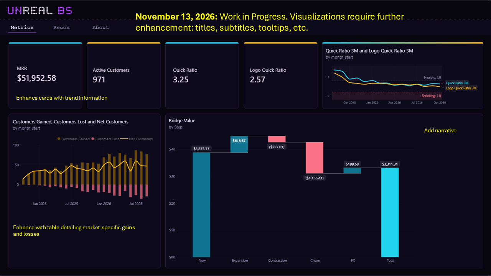

# A Power BI SaaS Business Example

*Work in progress (Nov 2026)*

This Power BI dashboard project follows the first two years of the fictional SaaS company, **Unreal Butler Services** (Unreal BS). 
The data is syntehtic, generated by Claude AI adhereing to data structures as if pulled from Stripe and QuickBooks. 
Unreal BS operates across 3 markets, and this dashboard offers the KPIs that monitor subscription health and displays
how that same data is represented in financial statements, demonstrating how different users may interpret the same information.

## Progress & Considerations

This build demonstrates the considerations taken when building out a new Power BI solution.

- [x] Plan visualizations.
- [x] Transform raw data for semantic model. 
- [x] Map relationships.
- [x] Create _Measures table.

**Metrics Dashboard**
 
- [x] Measures for Metrics dashboard.
- [x] Create visualizations.
- [x] Establish layout and design profile. 
- [ ] Enhance visualizations: tooltips, narratives, and additional information.
- [ ] Test visual interactions.

** Recon / Financials Dashboard**

- [ ] Measures for Recon dashboard.
- [ ] Create visualizations.
- [ ] Establish layout and design profile.
- [ ] Enhance visualizations: tooltips, narratives, and additional information.
- [ ] Test visual interactions.

** About Dashboard **

- [ ] Compile decisions CSV and load into semantic model as disconnected table.
- [ ] Create visualizations.
- [ ] Establish layout and design profile.
- [ ] Enhance visualizations: tooltips, narratives, and additional information.
- [ ] Test visual interactions.

** Clean up and documentaiton ** 

- [ ] Documentaiton for metric definitions.
- [ ] Semantic model clean up: measure folders, business-ready column names, hide unnecessary columns.
- [ ] Documentation on semantic model.
- [ ] Comment TMDL

## How to open it

1. Clone or download this repo.6
2. Open `powerbi/DoesItTie.pbip` in Power BI Desktop.
3. Refresh. Data loads straight from the CSVs in this repo.
